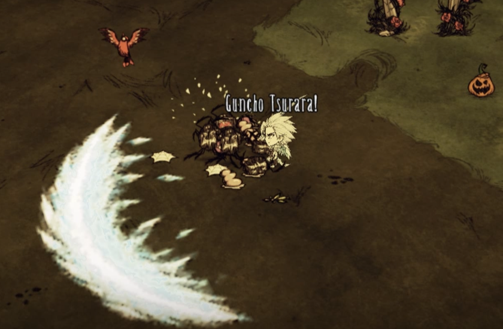

# 冬狮郎 · 冰轮丸（Don't Starve Together）

当前版本：**1.3.5**，对应 [Steam 创意工坊条目 3831773235](https://steamcommunity.com/sharedfiles/filedetails/?id=3831773235)。[完整玩法说明与强化配方](docs/workshop-description-zh.txt)。服务器和所有客户端均需启用本版，请停用原版 Workshop 736626219，避免同时加载。

本仓库从已发布、下载回读并核对的 Mod 包建立，用于继续开发。它不是原开发仓库的完整恢复：原提交历史、原 UT、资源生成脚本和可编辑美术源文件尚未取得。运行文件的原有署名和说明保留在 [CREDITS.txt](CREDITS.txt)，没有另行声明新的授权协议。

## 当前操作

- F：游戏原生攻击键；实际目标选择遵循原版规则。
- X：默认开启或解除卍解；旧存档的 Z 变身配置会自动按 X 处理，其他自定义键保留。
- Z：冰天百花葬，范围普通 10／卍解 20，同时冻结、扑灭明火与阴燃；冷却 10 秒，通常消耗 10 理智。
- 卍解需要至少 60 理智，开启消耗 10，降至 20 自动解除。攻击提升 50%、攻速提升 30%、移速提升 25%，保留原有 50% 伤害吸收。
- Z 冻结总时长普通 3 秒／卍解 10 秒，Boss 减半；保留原版抗性、免疫与受击破冰，不冻结玩家。
- 手持冰轮丸，每连续两次有效攻击触发前方剑气；普通半径 4／卍解 8，最多命中 6 个目标。
- 临水施放 Z 可生成冰川：普通小型产 3 冰，卍解大型产 7 冰；制冰独立冷却 60 秒，每人跨分片最多两座，新顶旧且旧冰川不掉冰。寿命两个游戏日、不再生，保留原版碰撞及采矿手感。
- 冬狮郎鬼魂作祟生物可施加寒冷，成功冻结默认总计 5 秒；羽织提供 8 格容量，食物腐败速度降低 90%。
- 手持冰轮丸，通过角色制作栏按顺序强化至 IV 阶，提升伤害并降低卍解维持消耗。材料与战斗回理智条件见完整说明。



## 目录与开发

根目录的 `modinfo.lua`、`modmain.lua`、`scripts/`、`anim/`、`bigportraits/`、`images/`、`modicon.*`、`CREDITS.txt` 是运行文件。其他目录用于开发规则、记录及测试。

- [1.3.5 发布文件清单及 SHA-256](docs/release-1.3.5-manifest.json)：65 个运行文件；原导入清单仍保留。
- [能力实现说明](docs/abilities-1.3.5.md)及[制冰说明](docs/ice-generation.md)。
- [验证范围与已知限制](docs/validation.md)。
- [开发规则](rules/rules.md)。

请在此仓库修改并保留版本记录，不要将 Steam 自动管理的订阅目录当作唯一源码。发布只打包运行文件，排除 `.git/`、开发文档、测试环境和日志。内容变更后递增 `modinfo.lua` 的版本，并通过官方 ModUploader 更新原条目。

## 重跑现有隔离检查

需要 Python 3 和 Lua 5.1 后端的 `lupa`：

```powershell
py -3 -m pip install -r tests/requirements.txt
py -3 tests/check_keybindings.py
py -3 tests/check_ice.py
py -3 tests/check_abilities.py
py -3 tests/check_haunt_timing.py --scripts "游戏目录/data/databundles/scripts.zip"
```

当前隔离检查共 124 项、35 个 Lua 文件编译通过，覆盖按键、制冰、能力和原生冻结组件时序。断言失败时退出码非零。这是新增的有限回归检查，不是原开发仓库的 UT，也不代表完整覆盖率、多人全场景或性能验收。游戏原生脚本仅供本地测试，不纳入仓库。

后续拿到原仓库后，按文件差异合并这里的提交，不覆盖原历史。
